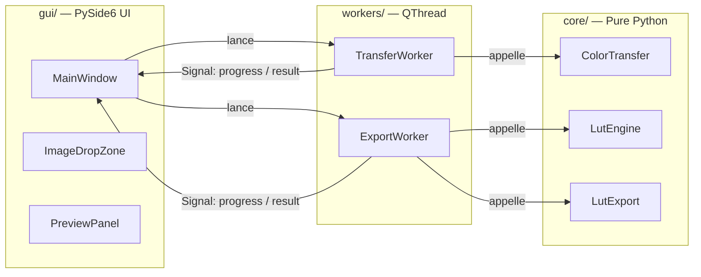
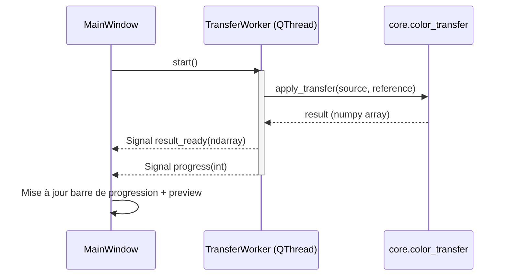
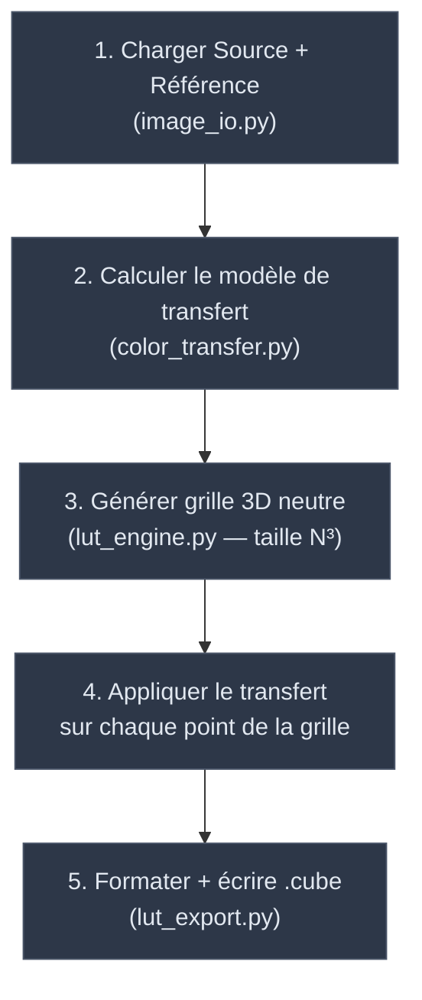
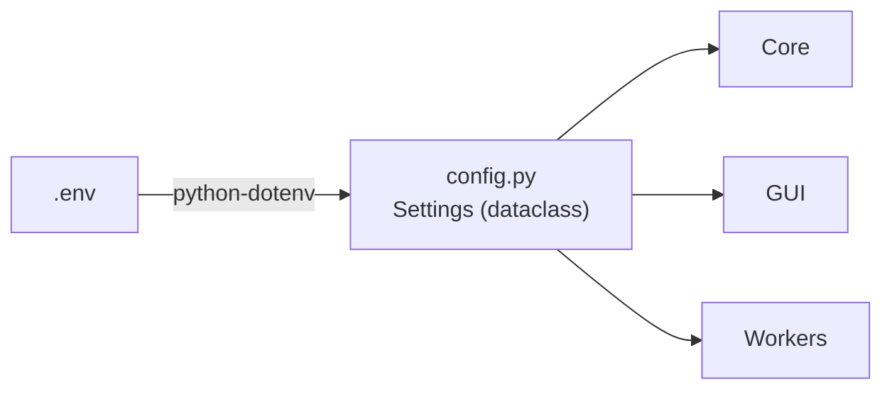
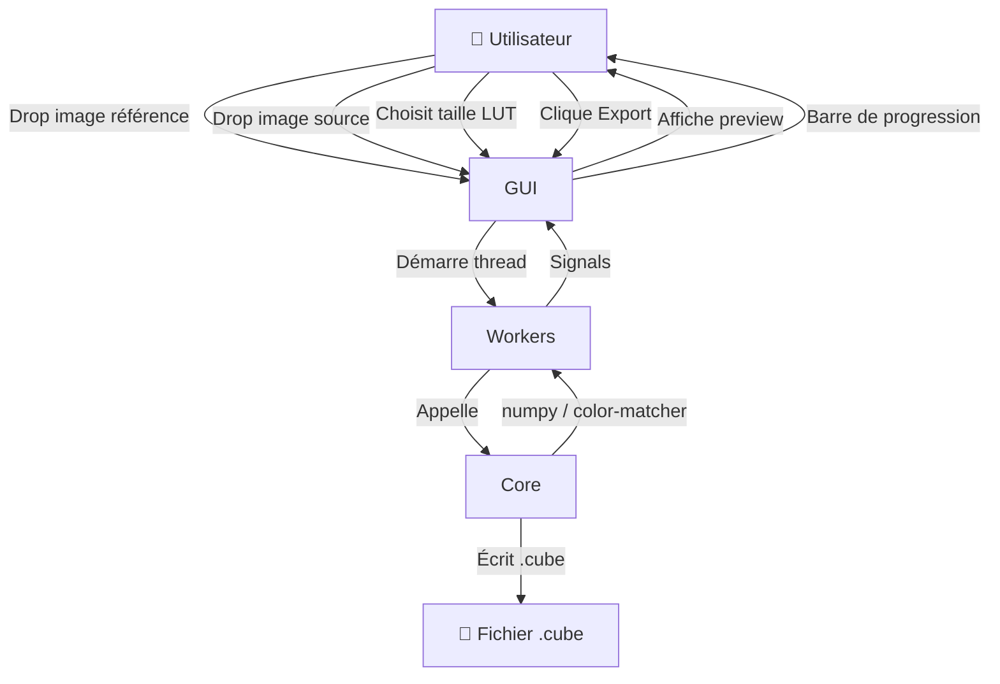

# StealZaLut — Architecture Document

> **Version :** 0.1.0  
> **Dernière mise à jour :** 2026-10-29  
> **Auteur :** Mathieu

---

## 1. Vue d'ensemble

StealZaLut est une application de bureau permettant de :

1. Charger une **image de référence** (dont on veut "voler" la colorimétrie).
2. Charger une **image source** (sur laquelle on veut appliquer le look).
3. Calculer le **transfert colorimétrique** par transport optimal (Monge–Kantorovitch).
4. Générer un fichier **3D LUT `.cube`** réutilisable dans tout logiciel compatible (Lightroom, DaVinci Resolve, Photoshop…).

L'architecture suit un patron **MVC simplifié** (Model → Workers → View) avec un découplage strict entre la logique métier pure, les tâches asynchrones Qt, et l'interface graphique.

---

## 2. Arborescence du projet

```
StealZaLut/
├── pyproject.toml              # Métadonnées PEP 621 + dépendances (uv / hatch)
├── .env.example                # Variables d'environnement documentées
├── .env                        # Configuration locale (ignoré par git)
├── ARCHITECTURE.md             # Ce document
├── README.md
│
├── src/
│   └── stealzalut/
│       ├── __init__.py         # Version, métadonnées package
│       ├── main.py             # Point d'entrée — bootstrap QApplication
│       ├── config.py           # Chargement .env + dataclass Settings
│       │
│       ├── core/               # ★ LOGIQUE MÉTIER PURE (aucune dépendance Qt)
│       │   ├── __init__.py
│       │   ├── color_transfer.py   # Wrapper autour de color-matcher
│       │   ├── lut_engine.py       # Génération de la grille 3D neutre (numpy)
│       │   └── lut_export.py       # Sérialisation au format .cube
│       │
│       ├── gui/                # ★ COUCHE PRÉSENTATION (PySide6)
│       │   ├── __init__.py
│       │   ├── main_window.py      # Fenêtre principale
│       │   ├── widgets/
│       │   │   ├── __init__.py
│       │   │   ├── image_drop_zone.py  # Widget drag-and-drop
│       │   │   └── preview_panel.py    # Panneau de prévisualisation
│       │   └── styles/
│       │       └── theme.qss           # Feuille de style Qt
│       │
│       ├── workers/            # ★ COUCHE ASYNCHRONE (QThread + Signals)
│       │   ├── __init__.py
│       │   ├── transfer_worker.py  # Thread : calcul du transfert couleur
│       │   └── export_worker.py    # Thread : baking + export .cube
│       │
│       └── utils/              # Utilitaires transverses
│           ├── __init__.py
│           ├── paths.py            # Résolution PyInstaller (sys._MEIPASS)
│           └── image_io.py         # Lecture/écriture images (cv2 + numpy)
│
├── tests/                      # Tests unitaires (pytest)
│   ├── __init__.py
│   ├── test_color_transfer.py
│   ├── test_lut_engine.py
│   └── test_lut_export.py
│
└── assets/                     # Ressources statiques (icônes, images)
    └── icons/
```

---

## 3. Principes d'architecture

### 3.1 Découplage en trois couches



| Couche | Responsabilité | Dépendance Qt ? |
|--------|---------------|-----------------|
| **`core/`** | Calculs mathématiques purs : transfert couleur, génération de grille, écriture `.cube`. | **Non** — 100 % testable sans Qt. |
| **`workers/`** | Encapsulation des appels `core/` dans des `QThread`. Émission de `Signal` pour la progression et les résultats. | **Oui** — `PySide6.QtCore` uniquement. |
| **`gui/`** | Affichage, interaction utilisateur, drag-and-drop, barre de progression. | **Oui** — `PySide6.QtWidgets`. |

> [!IMPORTANT]
> Le module `core/` ne doit **jamais** importer quoi que ce soit de `PySide6`. Cette règle garantit que toute la logique métier reste testable avec `pytest` sans instancier de `QApplication`.

### 3.2 Communication GUI ↔ Workers



Les `QThread` émettent trois types de signaux :

| Signal | Type émis | Usage |
|--------|-----------|-------|
| `progress` | `int` (0–100) | Mise à jour de la barre de progression |
| `result_ready` | `object` | Résultat du calcul (ndarray ou chemin fichier) |
| `error` | `str` | Message d'erreur affiché dans la GUI |

### 3.3 Pipeline de génération du `.cube`



La grille neutre de taille `N` est un tableau `numpy` de forme `(N³, 3)` dont chaque triplet RGB couvre uniformément l'espace `[0, 1]`. On y applique le même modèle de transfert que sur l'image source, puis on écrit les triplets résultants au format texte `.cube`.

### 3.4 Taille dynamique du LUT

| Taille `N` | Nombre de points (`N³`) | Taille fichier `.cube` approx. |
|:-----------:|:-----------------------:|:------------------------------:|
| 17 | 4 913 | ~150 Ko |
| 33 | 35 937 | ~1,1 Mo |
| 64 | 262 144 | ~8 Mo |

L'utilisateur choisit la taille via un menu déroulant dans la GUI. Le worker transmet cette valeur au `LutEngine` qui génère la grille correspondante.

---

## 4. Gestion de la configuration



Le module `config.py` :

1. Charge le fichier `.env` via `python-dotenv`.
2. Expose une **dataclass `Settings`** avec des valeurs typées et des valeurs par défaut.
3. Est importé par les trois couches comme source unique de configuration.

---

## 5. Compatibilité PyInstaller

Le module `utils/paths.py` centralise la résolution des chemins de ressources :

```
Si sys._MEIPASS existe → on est dans un bundle PyInstaller
Sinon → on utilise le chemin relatif au fichier source
```

Tout accès à un fichier asset (icône, QSS…) passe par ce module, garantissant le fonctionnement identique en développement et après packaging.

---

## 6. Stratégie de tests

| Module | Testabilité | Outil |
|--------|-------------|-------|
| `core/` | ✅ Tests unitaires directs | `pytest` + `numpy.testing` |
| `workers/` | ✅ Tests d'intégration avec `QApplication` | `pytest` + `pytest-qt` (optionnel) |
| `gui/` | ⚠️ Tests manuels / snapshot | Validation visuelle |

> [!TIP]
> La séparation `core/` pur permet d'atteindre une couverture de test élevée sur la logique métier sans aucune dépendance GUI.

---

## 7. Flux de données global



