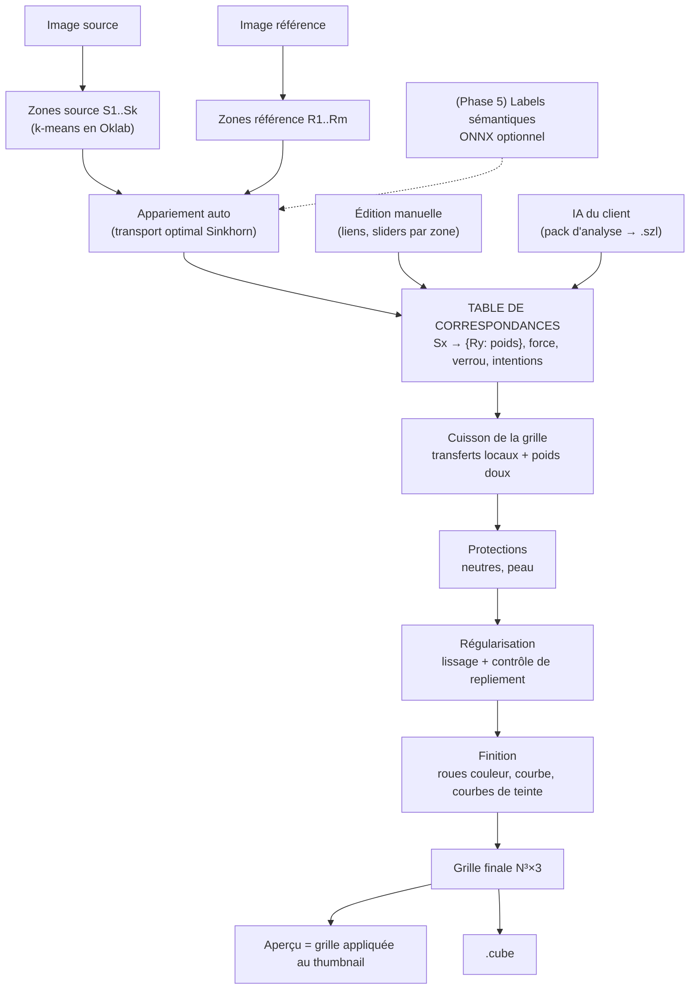

# StealZaLut — Architecture des Fonctionnalités Avancées (v2)

> **Objectif :** que le `.cube` applique *les bonnes couleurs aux bons endroits*, même quand la source et la référence n'ont pas le même contenu.
> **Idée centrale :** une **table de correspondances entre zones de couleur** (source ↔ référence), éditable à la main, pré-remplie automatiquement, et que l'IA *du client* peut écrire.
> **Dernière mise à jour :** 2026-11-09 — remplace la v1 (Grid Modifier Pipeline + SGLB + recette paramétrique).

Ce document est destiné à être donné tel quel à Claude (ou à un autre développeur) pour l'implémentation. Il contient le contexte du projet nécessaire : inutile de ré-explorer tout le dépôt avant de commencer.

---

## 0. Contexte du projet (à lire en premier)

### 0.1. Ce que fait l'application aujourd'hui

Application de bureau Python (PySide6). L'utilisateur dépose une **image source** et une **image de référence**, choisit un algorithme, voit un aperçu et exporte une **3D LUT `.cube`** (17/33/64) utilisable dans Lightroom, Resolve, Photoshop…

| Fichier | Rôle |
|---|---|
| `src/stealzalut/core/color_transfer.py` | `ColorTransferEngine` : `transfer_image()` (aperçu via la lib `color-matcher`), `bake_grid()` → `_bake_grid_impl()` (réimplémentation NumPy de `mkl`, `mvgd`, `reinhard`, `hm`, `hm-mkl-hm`, `hm-mvgd-hm` appliquée aux points de la grille). `_compute_mkl_matrix(cov_s, cov_r)` est générique (marche aussi en 2×2). |
| `src/stealzalut/core/lut_engine.py` | `generate_neutral_grid(size)` → `(size³, 3)` float64 dans [0,1], **R varie le plus vite, B le plus lentement** (convention `.cube`). Donc `grid.reshape(N, N, N, 3)` s'indexe `[b, g, r]`. `VALID_LUT_SIZES = {17, 33, 64}`. |
| `src/stealzalut/core/lut_export.py` | `write_cube_file(path, grid, size, title, progress_callback)`. |
| `src/stealzalut/workers/transfer_worker.py` | `QThread` d'aperçu : appelle `transfer_image()` sur les images. |
| `src/stealzalut/workers/export_worker.py` | `QThread` d'export : grille neutre → `bake_grid()` par morceaux → `.cube`. |
| `src/stealzalut/gui/main_window.py` | Fenêtre : 2 drop zones, choix de méthode, aperçu, bouton export. |
| `src/stealzalut/gui/widgets/` | `image_drop_zone.py`, `preview_panel.py`. |
| `src/stealzalut/utils/image_io.py` | Chargement JPEG/PNG/HEIC/RAW/DNG (rawpy → sRGB 8 bits + `enhance_raw_photographic`). `create_thumbnail(img, max_size=512)`. Les images sont chargées en **BGR** puis converties en RGB (`bgr_to_rgb`). |
| `src/stealzalut/config.py` | `Settings` (dont `preview_max_size`, défaut 512) chargés depuis `.env`. |

### 0.2. Conventions à respecter

- `core/` = **logique pure, aucune dépendance Qt**. `workers/` = `QThread` qui communiquent uniquement par `Signal`. `gui/` = présentation.
- Toutes les fonctions publiques du core prennent des images **RGB uint8** `(H, W, 3)`.
- Typage strict : `mypy --strict`, `ruff` (ligne 100, règles E F W I N UP B A SIM RUF). Docstrings style Google, comme le code existant.
- Tests `pytest` dans `tests/` (un fichier par module core).
- Dépendances actuelles : PySide6, numpy, opencv-python, color-matcher, python-dotenv, Pillow, pillow-heif, rawpy. **Ajout autorisé : `scipy`** (PCHIP, éventuellement `ndimage`). Pas de PyTorch. `onnxruntime` seulement en phase 5.

### 0.3. Défauts actuels à corriger au passage

1. **L'aperçu ne montre pas ce qui est exporté.** L'aperçu utilise `color-matcher` sur l'image, l'export utilise `_bake_grid_impl` sur la grille : ce sont deux implémentations différentes. L'aperçu doit appliquer **la grille elle-même** au thumbnail (cf. §3.2).
2. `ExportWorker` appelle `bake_grid()` sur ~30 morceaux, et **chaque appel recalcule les statistiques des deux images**. Il faut calculer le modèle une fois, puis l'appliquer.
3. Le transfert travaille en **sRGB encodé gamma**, où luminance et chroma sont mélangées. Le contraste de la référence est copié en même temps que ses couleurs : c'est la cause principale de l'effet « filtre mal fait ».

---

## 1. Diagnostic : pourquoi le résultat ressemble à un filtre raté

Une méthode globale (MKL, Reinhard…) résume chaque image par **une seule** distribution (moyenne + covariance) et calcule **une seule** transformation. Conséquences :

- **Biais de proportions** : si la référence contient 70 % de ciel orange, *toute* la source part vers l'orange, y compris la peau et la végétation.
- **Aucune notion de « quoi va où »** : le feuillage de la source n'a aucune raison de prendre la couleur de quoi que ce soit en particulier dans la référence.
- **Luminance et couleur couplées** : un contraste fort dans la référence écrase celui de la source.

### Contrainte physique incontournable

Une LUT est une fonction `RGB → RGB`, **sans information spatiale**. Deux pixels de même couleur reçoivent forcément le même traitement. On ne peut donc pas « dire à la LUT » qu'un pixel est du ciel. Mais on peut :
1. découper l'**espace des couleurs de la source** en zones qui correspondent, dans la plupart des photos, à des éléments distincts (feuillage, ciel, peau, ombres…) ;
2. donner à **chaque zone sa propre cible** dans la référence ;
3. mélanger ces transformations de façon douce dans la grille.

Quand deux éléments de la source ont la même couleur mais demandent des traitements différents, **aucun `.cube` ne peut les séparer**. L'application doit le **détecter et l'afficher** (§4.7), pas le cacher.

### Pourquoi la v1 ne suffisait pas (résumé)

- Le SGLB appariait les classes par label (ciel ↔ ciel) : quand le contenu diffère, rien ne s'apparie et on retombe sur le transfert global.
- MobileNetV3-DeepLabV3 (PASCAL VOC) **n'a pas de classe ciel, eau, végétation ou route**.
- La recette LLM demandait à l'IA des valeurs numériques précises (lift, gamma…), ce que les LLM estiment très mal, et ne disait jamais *où* appliquer quoi.
- Bugs : masque peau (échelles HSV OpenCV float mal interprétées), Hue-vs-Hue quantifié en `uint8` (banding), pas de régularisation de la grille.

---

## 2. Vue d'ensemble de la solution



Principes :
- **Tout le calcul couleur se fait en Oklab** (L = luminance perceptuelle, a/b = chroma). Retour en sRGB seulement à la fin.
- La cuisson travaille en **champ de déplacement** : `sortie = entrée + Δ`. Une zone verrouillée ou de force 0 donne `Δ = 0`, c'est-à-dire l'identité, sans cas particulier.
- **Trois sources d'intelligence, un seul objet** : l'auto-matching, l'utilisateur et l'IA du client éditent *la même table*. Le moteur ne sait pas qui l'a remplie.
- Toujours **un seul `.cube` standard** en sortie.

---

## 3. Fondations (phase 0)

### 3.1. `core/colorspace.py` — sRGB ↔ Oklab

Formules officielles d'Oklab (Björn Ottosson). Entrées/sorties en float64, sRGB dans [0, 1].

```python
import numpy as np
from numpy.typing import NDArray

F64 = NDArray[np.float64]

_M1 = np.array([[0.4122214708, 0.5363325363, 0.0514459929],
                [0.2119034982, 0.6806995451, 0.1073969566],
                [0.0883024619, 0.2817188376, 0.6299787005]])
_M2 = np.array([[0.2104542553, 0.7936177850, -0.0040720468],
                [1.9779984951, -2.4285922050, 0.4505937099],
                [0.0259040371, 0.7827717662, -0.8086757660]])
_M2_INV = np.array([[1.0, 0.3963377774, 0.2158037573],
                    [1.0, -0.1055613458, -0.0638541728],
                    [1.0, -0.0894841775, -1.2914855480]])
_M1_INV = np.array([[4.0767416621, -3.3077115913, 0.2309699292],
                    [-1.2684380046, 2.6097574011, -0.3413193965],
                    [-0.0041960863, -0.7034186147, 1.7076147010]])


def srgb_to_linear(c: F64) -> F64:
    return np.where(c <= 0.04045, c / 12.92, ((c + 0.055) / 1.055) ** 2.4)


def linear_to_srgb(c: F64) -> F64:
    c = np.clip(c, 0.0, None)
    return np.where(c <= 0.0031308, 12.92 * c, 1.055 * np.power(c, 1 / 2.4) - 0.055)


def srgb_to_oklab(rgb: F64) -> F64:
    """(N, 3) sRGB [0,1] → (N, 3) Oklab."""
    lms = srgb_to_linear(rgb) @ _M1.T
    return np.cbrt(lms) @ _M2.T


def oklab_to_linear(lab: F64) -> F64:
    return ((lab @ _M2_INV.T) ** 3) @ _M1_INV.T


def oklab_to_srgb(lab: F64) -> F64:
    """(N, 3) Oklab → (N, 3) sRGB [0,1] (à faire précéder de gamut_compress)."""
    return np.clip(linear_to_srgb(oklab_to_linear(lab)), 0.0, 1.0)


def oklab_to_oklch(lab: F64) -> F64:
    c = np.hypot(lab[:, 1], lab[:, 2])
    h = np.degrees(np.arctan2(lab[:, 2], lab[:, 1])) % 360.0
    return np.stack([lab[:, 0], c, h], axis=1)


def oklch_to_oklab(lch: F64) -> F64:
    h = np.radians(lch[:, 2])
    return np.stack([lch[:, 0], lch[:, 1] * np.cos(h), lch[:, 1] * np.sin(h)], axis=1)


def gamut_compress(lab: F64, iters: int = 12) -> F64:
    """Réduit la chroma des points hors gamut sRGB (teinte et L conservées).

    Évite les virages de teinte qu'un simple clip RGB produirait.
    """
    lab = lab.copy()
    lab[:, 0] = np.clip(lab[:, 0], 0.0, 1.0)
    lin = oklab_to_linear(lab)
    out = np.any((lin < -1e-6) | (lin > 1 + 1e-6), axis=1)
    if not out.any():
        return lab
    L, ab = lab[out, :1], lab[out, 1:]
    lo, hi = np.zeros(len(L)), np.ones(len(L))
    for _ in range(iters):
        mid = 0.5 * (lo + hi)
        cand = np.concatenate([L, ab * mid[:, None]], axis=1)
        lin_c = oklab_to_linear(cand)
        ok = np.all((lin_c >= -1e-6) & (lin_c <= 1 + 1e-6), axis=1)
        lo, hi = np.where(ok, mid, lo), np.where(ok, hi, mid)
    lab[out, 1:] = ab * lo[:, None]
    return lab
```

**Attention, la teinte n'est pas définie pour les gris** (C ≈ 0) : toute opération pilotée par la teinte doit être pondérée par `smoothstep(C, 0.01, 0.04)`.

Tests : aller-retour sRGB → Oklab → sRGB (erreur < 1e-5 sur la grille 33³ ; mesuré ≈ 1.7e-6, dû à l'arrondi des coefficients publiés), blanc → L≈1, a≈b≈0, noir → L=0, gris → a≈b≈0.

### 3.2. `core/lut_apply.py` — aperçu fidèle à l'export

```python
def apply_lut(image_rgb: NDArray[np.uint8], grid: F64, size: int) -> NDArray[np.uint8]:
    """Applique une grille (size³, 3) à une image par interpolation trilinéaire."""
    lut = grid.reshape(size, size, size, 3)          # indexé [b, g, r]
    x = image_rgb.reshape(-1, 3).astype(np.float64) / 255.0 * (size - 1)
    i0 = np.clip(np.floor(x).astype(np.int64), 0, size - 2)
    f = x - i0
    r0, g0, b0 = i0[:, 0], i0[:, 1], i0[:, 2]
    fr, fg, fb = f[:, 0:1], f[:, 1:2], f[:, 2:3]
    out = np.zeros_like(x)
    for db, wb in ((0, 1 - fb), (1, fb)):
        for dg, wg in ((0, 1 - fg), (1, fg)):
            for dr, wr in ((0, 1 - fr), (1, fr)):
                out += wb * wg * wr * lut[b0 + db, g0 + dg, r0 + dr]
    return (np.clip(out, 0, 1) * 255 + 0.5).astype(np.uint8).reshape(image_rgb.shape)
```

- L'aperçu (`TransferWorker`) devient : *construire la grille* → `apply_lut(thumbnail, grid, 33)`. Pour l'aperçu interactif, une grille **33³** suffit ; l'export recalcule à la taille choisie.
- Test : `apply_lut(img, generate_neutral_grid(N), N) == img` (à ±1 près).

### 3.3. Modèle calculé une fois

Introduire un objet `TransferModel` (dataclass gelée) qui contient tout ce qui dépend des images (zones, stats, appariement). La cuisson devient une fonction pure `bake(model, table, params, grid) -> grid`. `ExportWorker` ne recalcule plus rien par morceau.

Les méthodes existantes (`mkl`, `reinhard`, `hm`…) restent disponibles en **« Mode classique »**, utile pour comparer et pour la non-régression.

---

## 4. Moteur de correspondances (phases 1 et 2)

### 4.1. `core/palette.py` — découpage en zones

1. Réduire l'image (côté max 256 px, `cv2.INTER_AREA`) puis la convertir en Oklab.
2. `cv2.kmeans` en float32 avec `cv2.KMEANS_PP_CENTERS`, `attempts=3`, **`cv2.setRNGSeed(0)` avant l'appel** pour un résultat déterministe (indispensable pour le pack IA, §5).
3. K par défaut : **8** (réglable de 4 à 16). Fusionner les zones de moins de 1 % de surface dans la plus proche.
4. Trier les zones par L croissante et les numéroter `1..K` (stable, lisible).
5. Pour chaque zone, calculer :

```python
@dataclass(frozen=True, slots=True)
class Zone:
    id: int                 # 1..K
    mean: F64               # (3,) Oklab
    cov: F64                # (3, 3) Oklab, + 1e-5·I
    area: float             # fraction de pixels [0, 1]
    l_rank: float           # rang de luminance pondéré par surface [0, 1]
    centroid_xy: tuple[float, float]   # en % de l'image
    bbox: tuple[float, float, float, float]  # x0, y0, x1, y1 en %
    hex: str                # couleur moyenne en sRGB, pour l'UI et le pack
```

`l_rank` = position de la zone dans la distribution cumulée de luminance de *son* image (0 = zone la plus sombre). C'est ce qui rend l'appariement robuste à une différence d'exposition.

Conserver aussi la **carte des labels** à la taille du thumbnail (`cv2.resize(..., INTER_NEAREST)`). Elle sert à surligner une zone dans l'aperçu et à produire le pack IA.

### 4.2. `core/matching.py` — appariement automatique

Coût entre une zone source `i` et une zone référence `j` :

$$C_{ij} = w_L\,(\ell_i - \ell_j)^2 + w_C\,\frac{\lVert ab_i - ab_j\rVert^2}{s_{ab}^2} + w_{sem}\,S_{ij}$$

- `ℓ` = `l_rank` (les ombres vont vers les ombres, les hautes lumières vers les hautes lumières) ;
- `ab` = chroma moyenne, `s_ab` = écart-type des chromas des zones des deux images ;
- `S_ij` = distance sémantique (phase 5, 0 sinon). Défauts : `w_L = 1.0`, `w_C = 0.5`.

Résolution par **transport optimal entropique (Sinkhorn)**, avec les surfaces comme marges. On obtient un plan doux (une zone source peut viser plusieurs zones référence), sans dépendance supplémentaire :

```python
def sinkhorn(cost: F64, a: F64, b: F64, eps: float = 0.05, iters: int = 200) -> F64:
    """Plan de transport P (k, m) avec P·1 = a et Pᵀ·1 = b."""
    K = np.exp(-cost / max(eps, 1e-6))
    u, v = np.ones_like(a), np.ones_like(b)
    for _ in range(iters):
        u = a / (K @ v + 1e-300)
        v = b / (K.T @ u + 1e-300)
    return u[:, None] * K * v[None, :]
```

La cible auto de la zone source `i` est la ligne `P[i] / P[i].sum()`. Pour la lisibilité, ne garder que les poids > 0.1 et renormaliser.

### 4.3. `core/correspondence.py` — la table

```python
Level = Literal["-large", "-medium", "-small", "0", "+small", "+medium", "+large"]

@dataclass(frozen=True, slots=True)
class Intent:
    lightness: Level = "0"
    saturation: Level = "0"
    warmth: Level = "0"      # + = plus chaud (jaune/orangé), - = plus froid
    tint: Level = "0"        # + = magenta, - = vert

@dataclass(frozen=True, slots=True)
class Link:
    source_zone: int
    targets: dict[int, float]          # {ref_zone_id: poids}, somme = 1 ; vide = « garder »
    strength: float = 1.0              # 0 = identité
    luminance_strength: float | None = None   # None = valeur globale
    chroma_strength: float | None = None
    locked: bool = False               # True = zone intouchable (Δ = 0)
    intent: Intent = Intent()
    origin: Literal["auto", "user", "ai"] = "auto"
    rationale: str = ""                # explication (IA) affichée en tooltip

@dataclass(frozen=True, slots=True)
class CorrespondenceTable:
    links: tuple[Link, ...]            # exactement une entrée par zone source
```

Table *immuable* : chaque édition crée une nouvelle table, ce qui donne undo/redo gratuitement (pile de tables).

### 4.4. `core/palette_transfer.py` — cuisson

**a) Cible de chaque lien.** Les zones référence visées forment un mélange. On le résume par ses moments :

$$\mu^* = \sum_j w_j\,\mu_j,\qquad \Sigma^* = \sum_j w_j\left(\Sigma_j + (\mu_j-\mu^*)(\mu_j-\mu^*)^\top\right)$$

**b) Transfert local découplé** (zone source `k` → cible) :
- **Luminance** (scalaire) : `L' = μ*_L + κ·(L − μ_L)` avec `κ = clip(σ*_L / σ_L, 0.5, 2.0)`.
- **Chroma** (2×2) : `ab' = μ*_ab + T_ab·(ab − μ_ab)`, avec `T_ab = _compute_mkl_matrix(Σ_ab, Σ*_ab)` (fonction existante), puis valeurs singulières de `T_ab` bornées à [0.5, 2.0] via SVD. Sans ces bornes, une zone presque uniforme fait exploser la transformation.

Déplacement du point `c` dû à la zone `k` :

$$\Delta_k(c) = s_k \cdot \big[\,\alpha_L\,(L'-L),\ \alpha_C\,(ab'-ab)\,\big] + \delta_{intent,k}$$

avec `s_k` = `strength` (0 si `locked`), `α_L`, `α_C` = forces luminance/chroma (du lien, sinon globales).

**c) Intentions → décalages déterministes** (c'est l'application qui chiffre, jamais l'IA) :

| Niveau | small | medium | large |
|---|---|---|---|
| `lightness` (ΔL) | ±0.02 | ±0.05 | ±0.10 |
| `saturation` (×C) | 1.08 / 0.92 | 1.20 / 0.82 | 1.40 / 0.65 |
| `warmth` (Δ sur l'axe `(0.29, 0.96)` en a,b) | ±0.010 | ±0.020 | ±0.040 |
| `tint` (Δa) | ±0.008 | ±0.016 | ±0.030 |

Ces valeurs sont un point de départ, à calibrer visuellement. Les mettre dans une table de constantes unique.

**d) Poids doux.** Chaque point de la grille (en Oklab) appartient plus ou moins à chaque zone source, plus une **composante globale** (transfert découplé calculé sur les images entières) pour les couleurs absentes de la source :

$$\text{logit}_k(c) = -\frac{1}{2\tau}\,(c-\mu_k)^\top(\Sigma_k+\sigma_0^2 I)^{-1}(c-\mu_k) + \beta\log \pi_k,\qquad \text{logit}_0 = b_0$$

$$G(c) = c + \sum_{k=0}^{K} \text{softmax}(\text{logit})_k\,\Delta_k(c)$$

Défauts : `τ = 1.0` (slider « Séparation des zones » : plus petit = zones plus nettes, plus grand = plus fondu), `σ0 = 0.02`, `β = 0.3`, `b0 = −4.5` (un point à plus de ~3σ de toute zone bascule vers le global).

```python
def bake_palette_transfer(grid_lab: F64, model: TransferModel,
                          table: CorrespondenceTable, p: BakeParams) -> F64:
    n, K = len(grid_lab), len(model.src_zones)
    logits = np.empty((n, K + 1))
    deltas = np.empty((K + 1, n, 3))
    for k, (zone, link) in enumerate(zip(model.src_zones, table.links), start=1):
        cov = zone.cov + p.sigma0**2 * np.eye(3)
        d = grid_lab - zone.mean
        m2 = np.einsum("ni,ij,nj->n", d, np.linalg.inv(cov), d)
        logits[:, k] = -0.5 * m2 / p.tau + p.beta * np.log(zone.area)
        deltas[k] = zone_delta(grid_lab, zone, link, model.ref_zones, p)
    logits[:, 0] = p.background_logit
    deltas[0] = global_delta(grid_lab, model.global_tf, p)
    logits -= logits.max(axis=1, keepdims=True)
    w = np.exp(logits)
    w /= w.sum(axis=1, keepdims=True)
    return grid_lab + np.einsum("nk,knd->nd", w, deltas)
```

Coût : 33³ ≈ 36 000 points × 9 composantes, quelques millisecondes. L'aperçu peut se recalculer à chaque mouvement de slider (avec un *debounce* de 50–100 ms dans un worker).

### 4.5. Protections (appliquées au déplacement total, avant régularisation)

`smoothstep(x, e0, e1)` = transition douce de 0 à 1. On calcule sur la couleur **d'entrée** (le point de la grille neutre).

- **Préserver les neutres** (slider 0–1, défaut 0.5) : `m_n = preserve · (1 − smoothstep(C_in, 0.02, 0.06))`, qui multiplie la composante **ab** du déplacement par `(1 − m_n)`. Les gris restent gris (balance des blancs conservée) ; la luminance reste libre.
- **Protection peau** (slider 0–1, défaut 0.5) : en Oklch, les tons chair sont autour de **h ≈ 35°–80°, C ≈ 0.03–0.15, L ≈ 0.35–0.92** (exemple calculé : sRGB (224,172,140) → L 0.78, C 0.075, h 53°). Masque = produit de fenêtres douces sur h, C, L. Il réduit le déplacement ab de `m_s` et le déplacement L de `0.5·m_s`. **Valeurs à calibrer** sur un petit jeu de visages variés (carnations claires à foncées) : écrire un test qui vérifie que ces couleurs tombent dans le masque.
- **Verrouiller une zone** (dans la table) : `Δ_k = 0`. C'est la protection la plus fiable, puisque l'utilisateur voit la zone surlignée.

### 4.6. `core/regularize.py` — grille lisse et sans repliement

Le mélange de transformations locales peut créer du banding ou des inversions (une couleur plus claire en entrée devient plus sombre en sortie). Deux garde-fous :

```python
def smooth_field(delta: F64, size: int, sigma_cells: float) -> F64:
    """Flou gaussien séparable du champ de déplacement sur la grille 3D."""
    f = delta.reshape(size, size, size, 3)
    r = max(1, int(3 * sigma_cells))
    x = np.arange(-r, r + 1)
    k = np.exp(-(x**2) / (2 * sigma_cells**2))
    k /= k.sum()
    for axis in range(3):
        pad = [(0, 0)] * 4
        pad[axis] = (r, r)
        fp = np.pad(f, pad, mode="edge")
        f = sum(k[i] * np.take(fp, np.arange(i, i + size), axis=axis) for i in range(len(k)))
    return f.reshape(-1, 3)
```

- `sigma_cells = lissage × (size − 1) / 32`, pour un résultat indépendant de la résolution de la LUT. Défaut `lissage = 1.0`.
- **Contrôle de repliement** : sur la grille `(N, N, N)`, la luminance de sortie doit être non décroissante le long de chaque axe R, G, B. Calculer la fraction de violations (`np.diff(L_out, axis) < -1e-3`). Si elle dépasse 0.5 %, augmenter automatiquement le lissage (×1.5, au plus 3 fois) et afficher un avertissement discret.

### 4.7. Détection des conflits (limite de la LUT)

Pour chaque paire de zones source `(i, j)`, calculer leur **recouvrement** dans l'espace couleur (coefficient de Bhattacharyya entre les deux gaussiennes). Si le recouvrement est élevé (> 0.5) **et** que leurs déplacements moyens diffèrent fortement (> 0.05 en Oklab), afficher :

> « Les zones S2 et S5 ont des couleurs trop proches pour être traitées différemment : la LUT va les mélanger. »

C'est l'honnêteté du produit : on montre la limite au lieu de produire un résultat bizarre sans explication.

### 4.8. Ordre complet du pipeline

```
grille neutre sRGB → Oklab
→ bake_palette_transfer (zones + global)       [§4.4]
→ protections neutres / peau                    [§4.5]
→ régularisation + contrôle de repliement        [§4.6]
→ mix global (Δ × mix)
→ finition : roues, courbe tonale, courbes teinte [§6]
→ gamut_compress → sRGB → clip → .cube
```

---

## 5. Pont avec l'IA du client (phase 3)

### 5.1. Principe : chacun fait ce qu'il sait faire

- **L'application** mesure (zones, couleurs exactes, surfaces, positions) et chiffre (transformations).
- **L'IA du client** (Claude, GPT, Gemini… dans sa propre interface, hors de l'app) fait le raisonnement sémantique : « la zone S3 est du feuillage, dans la référence la zone R5 (dunes chaudes) donne l'ambiance voulue ; la zone S1 est de la peau, à garder naturelle ».

L'IA **ne produit jamais de valeurs colorimétriques** : seulement des correspondances entre identifiants de zones, des forces sur des échelles qualitatives et des explications. C'est ce qui rend le résultat fiable. Et c'est ce qui répond exactement au besoin « savoir où appliquer quel changement quand les contextes diffèrent ».

L'application **n'appelle aucune API** : pas de clé, pas de réseau, pas de coût pour toi.

### 5.2. Export du « pack d'analyse »

Bouton **« Préparer pour mon IA »** → dossier `<nom>_stealzalut_pack/` (et un `.zip` du même contenu) :

| Fichier | Contenu |
|---|---|
| `1_source_zones.png` | Planche de vignettes : une par zone source, la zone en couleur et le reste grisé, étiquetée `S1`…`Sk` avec sa pastille de couleur et son % de surface. **C'est l'image la plus utile pour l'IA.** |
| `2_reference_zones.png` | Idem pour la référence, `R1`…`Rm`. |
| `3_source_overview.png` | Image source assombrie, contours des zones (`cv2.findContours` sur la carte de labels lissée par un filtre médian), étiquette `Sx` au centre de la plus grande composante connexe de chaque zone (`cv2.connectedComponentsWithStats`). |
| `4_reference_overview.png` | Idem pour la référence. |
| `analysis.json` | Données exactes (ci-dessous). |
| `PROMPT.md` | Le prompt à coller (§5.4). |

Images au plus 1024 px de côté : assez pour l'IA, légères à téléverser.

```json
{
  "format": "stealzalut.analysis",
  "version": 1,
  "analysis_id": "a3f9c2e1",
  "source": {
    "size": [6000, 4000],
    "zones": [
      {
        "id": 1, "hex": "#2b3a24", "area_pct": 18.2,
        "oklch": [0.31, 0.05, 128.0],
        "lightness_band": "shadows",
        "centroid_pct": [42.0, 71.0],
        "bbox_pct": [0.0, 45.0, 100.0, 100.0]
      }
    ]
  },
  "reference": { "size": [4000, 2667], "zones": [] },
  "auto_matching": [
    { "source_zone": 1, "targets": { "3": 0.8, "4": 0.2 } }
  ]
}
```

`analysis_id` = 8 premiers caractères du SHA-256 de (octets des deux thumbnails + K + version de l'algorithme). Grâce au découpage déterministe (§4.1), recharger les mêmes images avec le même K redonne le même identifiant et les mêmes zones.

### 5.3. Fichier recette `.szl` (v2)

Le même format sert à **trois usages** : réponse de l'IA, sauvegarde du travail de l'utilisateur (« Exporter recette »), et partage.

```json
{
  "format": "stealzalut.recipe",
  "version": 2,
  "analysis_id": "a3f9c2e1",
  "name": "Forêt vers ambiance dunes au couchant",
  "description": "Feuillage réchauffé vers les tons sable, peau naturelle, ciel adouci.",

  "global": {
    "luminance_strength": 0.5,
    "chroma_strength": 0.9,
    "preserve_neutrals": 0.4,
    "skin_protection": 0.7,
    "zone_separation": "medium",
    "mix": 1.0
  },

  "links": [
    {
      "source_zone": 3,
      "targets": { "5": 0.7, "2": 0.3 },
      "strength": "strong",
      "intent": { "warmth": "+small", "saturation": "-small" },
      "rationale": "Le feuillage n'a pas d'équivalent ; on lui donne la chaleur des dunes R5."
    },
    {
      "source_zone": 1,
      "keep": true,
      "rationale": "Peau du sujet : à préserver."
    }
  ],

  "finishing": null
}
```

Règles de lecture (`core/recipe.py`, validation à la main avec des dataclasses, sans nouvelle dépendance) :
- `strength` accepte un nombre [0–1] **ou** `"off" | "subtle" | "medium" | "strong" | "full"` → 0 / 0.3 / 0.6 / 0.85 / 1.0. `zone_separation` : `"sharp" | "medium" | "soft"` → τ = 0.5 / 1.0 / 2.0.
- `keep: true` → `locked = True`. Une zone source absente des `links` garde son lien auto.
- Identifiant de zone inconnu → **erreur explicite** qui nomme le lien fautif. Poids négatifs → erreur. Poids qui ne somment pas à 1 → renormalisés.
- `analysis_id` différent de l'analyse courante → avertissement bloquant : « Cette recette a été écrite pour d'autres zones. Recalculer avec K = … ? »
- Tout ce qui vient de l'IA est marqué `origin = "ai"` et son `rationale` s'affiche en infobulle.
- **Extraction tolérante** : l'IA a le droit d'écrire du texte. L'app (ou le bouton « Coller la réponse de l'IA ») extrait le **dernier** bloc ` ```json ` de la réponse.
- `finishing` (§6) est rempli par l'application quand l'utilisateur exporte sa propre recette ; l'IA le laisse à `null`.

### 5.4. `assets/prompts/PROMPT.md` (fourni dans le pack)

````markdown
# StealZaLut — Correspondance de couleurs entre deux images

Tu es étalonneur (coloriste) cinéma. Je veux donner à ma photo SOURCE l'ambiance
colorimétrique de ma photo RÉFÉRENCE, même si elles ne montrent pas la même chose.

Mon logiciel a découpé chaque image en zones de couleur. Fichiers joints :
- 1_source_zones.png : chaque zone de la source isolée, nommée S1, S2…
- 2_reference_zones.png : chaque zone de la référence, nommée R1, R2…
- 3_source_overview.png et 4_reference_overview.png : les images entières, zones entourées.
- analysis.json : mesures exactes et proposition automatique (auto_matching).

## Ta mission
1. Décris brièvement ce que représente chaque zone (ex. « S3 : feuillage en contre-jour »).
2. Pour chaque zone source, choisis quelle(s) zone(s) de la référence doivent lui
   donner sa couleur, en raisonnant sur le RÔLE et l'AMBIANCE (lumière principale,
   ombres, matière, sujet), pas sur la ressemblance de couleur. Tu peux répartir sur
   plusieurs zones avec des poids, ou garder la zone telle quelle (`"keep": true`).
3. Protège ce qui doit rester crédible : peau, éléments de marque, blancs.
4. Ajuste avec des intentions qualitatives si besoin (plus chaud, moins saturé…).
5. Corrige l'auto_matching seulement là où il est mauvais.

## Règles
- N'invente AUCUNE valeur de couleur (pas de RGB, hex, lift, gamma…).
- Utilise uniquement les identifiants présents dans analysis.json.
- Échelles : strength ∈ off | subtle | medium | strong | full ;
  intent.* ∈ -large | -medium | -small | 0 | +small | +medium | +large.
- Si les contextes sont très différents, préfère luminance_strength ≤ 0.5
  (on emprunte surtout la couleur, pas le contraste).
- Raisonne d'abord librement, puis termine par UN SEUL bloc ```json respectant
  exactement ce format :

```json
{ "format": "stealzalut.recipe", "version": 2, "analysis_id": "<copier depuis analysis.json>",
  "name": "...", "description": "...",
  "global": { "luminance_strength": 0.0-1.0, "chroma_strength": 0.0-1.0,
              "preserve_neutrals": 0.0-1.0, "skin_protection": 0.0-1.0,
              "zone_separation": "sharp|medium|soft", "mix": 0.0-1.0 },
  "links": [ { "source_zone": 1, "targets": { "2": 0.7, "4": 0.3 },
               "strength": "strong", "intent": { "warmth": "+small" },
               "rationale": "..." },
             { "source_zone": 2, "keep": true, "rationale": "..." } ],
  "finishing": null }
```
````

### 5.5. Variante sans pack (« profil de look »)

Le client peut aussi vouloir réutiliser une référence sans l'image. Bouton **« Sauver le look »** → `.szlook` = zones référence (moments Oklab, surfaces, hex) + vignette basse résolution. Charger un `.szlook` remplace l'image de référence dans le modèle. Utile pour se constituer une bibliothèque de looks. Priorité basse.

---

## 6. Outils de finition (phase 4)

Appliqués **après** la cuisson, en Oklab/Oklch, en float, sans quantification.

- **Roues couleur Ombres / Tons moyens / Hautes lumières** : base de Bernstein sur L : `ws = (1−L)²`, `wm = 2L(1−L)`, `wh = L²` (somme = 1). Chaque roue a un décalage de luminance et une teinte `(a, b)` : `L' = L + Σ w·ΔL`, `ab' = ab + Σ w·tint`. Cela correspond au « lift/gamma/gain » attendu par un utilisateur de Resolve, sans les instabilités de la formule ASC-CDL de la v1.
- **Courbe tonale** sur L uniquement : `scipy.interpolate.PchipInterpolator` (monotone, pas d'oscillation), points de contrôle triés, extrémités incluses. Agir sur L en Oklab ne modifie ni la teinte ni la chroma, donc pas de virage de couleur.
- **Courbes de teinte** (Hue vs Hue, Hue vs Sat, Hue vs Lum) : chaque réglage est une « bosse » `(centre_h, largeur, Δh, ×C, ΔL)` de poids `exp(−½·(dist_angulaire/largeur)²) · smoothstep(C, 0.01, 0.04)`. Le second facteur empêche d'agir sur les gris dont la teinte n'a pas de sens.
- **Saturation / vibrance globales** : `C' = C·sat` ; vibrance `C' = C·(1 + v·(1 − smoothstep(C, 0, 0.15)))`.
- **Mix global** (0–1) : multiplie tout le déplacement.

Tous ces réglages sont sérialisés dans `finishing` du `.szl`.

---

## 7. Interface (PySide6)

### 7.1. Panneau « Correspondances » (cœur de l'UX)

```
┌─ SOURCE ──────────┐                    ┌─ RÉFÉRENCE ───────┐
│ ■ S1  peau   9 %  │ ── verrou ──        │ ■ R1  ombres  22% │
│ ■ S2  ombres 21 % │ ═════════════════▶ │ ■ R2  sable   30% │
│ ■ S3  feuill.35 % │ ═══════════╗       │ ■ R3  ciel    18% │
│ ■ S4  ciel   25 % │ ─────╮      ╚════▶ │ ■ R4  soleil   9% │
└───────────────────┘      ╰──────────▶  └───────────────────┘
```

- Deux colonnes de pastilles (hauteur ∝ surface), reliées par des courbes de Bézier dont l'épaisseur ∝ poids. Couleur du trait selon l'origine : auto (gris), utilisateur (blanc), IA (violet).
- **Survol ou clic sur une pastille → la zone est surlignée sur l'aperçu correspondant** (overlay de la carte de labels). Indispensable pour que l'utilisateur comprenne ce qu'il manipule.
- Glisser d'une pastille source vers une pastille référence : remplace la cible. Avec Maj : ajoute une cible.
- Clic droit : *Verrouiller*, *Revenir à l'auto*, *Retirer une cible*.
- **Inspecteur** de la zone sélectionnée : Force, Force luminance, Force couleur, 4 sélecteurs d'intention (−−− … +++), poids de chaque cible, `rationale` de l'IA.
- Implémentation : `QGraphicsView`/`QGraphicsScene` dans `gui/widgets/correspondence_view.py`. Le widget émet `table_changed(CorrespondenceTable)`. Aucune logique couleur dans le widget.

### 7.2. Panneau « Réglages globaux »

Intensité luminance · Intensité couleur · Préserver les neutres · Protection peau · Séparation des zones (τ) · Nombre de zones K (relance le découpage, avec confirmation si des liens manuels existent) · Lissage · Mix.

### 7.3. Barre d'actions

*Mode classique / Mode zones* · *Avant / Après* (maintenir une touche) · *Préparer pour mon IA* · *Importer recette* (fichier ou « Coller la réponse de l'IA ») · *Exporter recette* · *Exporter .cube* · Undo/Redo (pile de tables + réglages).

Bandeau d'avertissements : conflits (§4.7), repliement corrigé (§4.6), recette d'une autre analyse (§5.3).

### 7.4. Threads

Nouveau `workers/bake_worker.py` : reçoit `(model, table, params)` et renvoie `(grid_33, preview_rgb)`. Debounce de 75 ms dans `MainWindow`. N'émettre que le **dernier** résultat demandé (identifiant de requête croissant, les résultats périmés sont ignorés). L'analyse (zones + appariement) se fait dans un worker séparé, une seule fois par paire d'images ou changement de K.

---

## 8. Sémantique par réseau de neurones (phase 5, optionnelle)

Seulement une fois les phases 0–3 livrées et utilisées. Le CNN ne crée **aucun masque spatial dans la LUT** (c'est impossible). Il sert à :
1. **Nommer les zones** dans l'UI et dans `analysis.json` (`label_hint` : « végétation 72 %, ciel 20 % ») : on compte les labels de segmentation des pixels de chaque zone.
2. **Améliorer l'appariement auto** via le terme `S_ij` du coût (§4.2).
3. **Affiner la détection de conflits** : une zone couleur qui mélange deux labels très différents (ex. peau + sable) est signalée.

| Option | Pourquoi | Points d'attention |
|---|---|---|
| **SegFormer-B0, ADE20K (150 classes)** en ONNX, ~15 Mo | Contient ciel, arbre, herbe, eau, sable, route, personne… | **Vérifier la licence des poids** (le code officiel NVIDIA est sous licence non commerciale) ; sinon chercher une alternative à licence permissive. |
| **DINOv2 ViT-S/14** en ONNX, ~85 Mo | Features génériques : permet de rapprocher des régions *de contenus différents mais de rôle similaire*, sans classes fixes. | Plus lourd ; licence Apache 2.0. |

Mise en œuvre : `onnxruntime` en dépendance **optionnelle** (`[project.optional-dependencies] ai = [...]`), modèle **téléchargé à la première utilisation** dans le dossier de données utilisateur (pas embarqué dans l'installeur), `InferenceSession` créée **une seule fois** et mise en cache, inférence dans un worker. Si l'option est absente, l'application fonctionne exactement comme en phase 3.

---

## 9. Feuille de route

| Phase | Contenu | Taille | Gain perçu |
|---|---|---|---|
| **0 — Fondations** | `colorspace.py`, `lut_apply.py`, aperçu = grille, `TransferModel` calculé une fois, Mode classique conservé | S | Aperçu fidèle, base saine |
| **1 — Transfert découplé** | Transfert global en Oklab avec forces luminance/chroma séparées, préserver neutres, protection peau, mix, régularisation | S–M | **Fort** : disparition d'une bonne partie de l'effet « filtre » |
| **2 — Moteur de zones** | `palette.py`, `matching.py`, `correspondence.py`, `palette_transfer.py`, conflits, panneau Correspondances + inspecteur, undo/redo | L | **Très fort** : les bonnes couleurs aux bons endroits |
| **3 — Pont IA** | Pack d'analyse, `PROMPT.md`, `.szl` v2 import/export, collage de réponse, `rationale` en infobulle | M | Cas « contextes différents » résolus par l'IA du client |
| **4 — Finition** | Roues, courbe tonale, courbes de teinte, saturation/vibrance, sérialisation `finishing` | M | Confort de retouche |
| **5 — Sémantique** | ONNX optionnel, labels de zones, terme sémantique dans l'appariement | L | Auto-matching meilleur, moins d'édition manuelle |

Les phases 3 et 4 sont indépendantes : on peut les inverser.

### Tests attendus (minimum)

- **Identités** : forces à 0, ou toutes les zones verrouillées, ou mix = 0 → grille de sortie = grille neutre (à 1e-9 près).
- **Oklab** : aller-retour, points de référence (blanc, noir, gris).
- **`apply_lut`** : grille neutre → image inchangée ; grille constante → image constante.
- **Déterminisme** : deux analyses des mêmes images → mêmes zones, même `analysis_id`.
- **Sinkhorn** : marges respectées à 1e-6.
- **Protections** : un gris pur ne change pas de chroma avec `preserve_neutrals = 1` ; des couleurs de peau de référence (claires à foncées) ont un masque > 0.8.
- **Régularisation** : sur un cas synthétique volontairement replié, la fraction de violations après correction est < 0.5 %.
- **Recette** : ID de zone inconnu → erreur claire ; extraction du dernier bloc JSON d'un texte libre ; aller-retour export → import identique.
- **Non-régression** : le Mode classique produit les mêmes `.cube` qu'avant.

### Non-objectifs (décisions prises)

- Pas de masques spatiaux dans la sortie : on livre toujours **un seul `.cube` standard**.
- L'application n'appelle aucune API d'IA ; l'IA du client reste hors de l'application.
- L'IA ne fournit jamais de valeurs numériques de couleur.
- Aucun modèle de deep learning embarqué avant la phase 5, et toujours en option.
